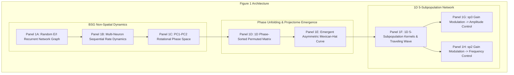

# Figure 1 Reproduction Plan: Balanced Sequence Generation & 1D Mexican-Hat Model

**Paper**: Komi et al., *Nature Communications* (2026)  
**Title**: Emergence of Traveling Waves and Decoupled Motor Control in Spinal Projectomes  
**Original Repository Reference**: BergLab MATLAB Codebase (`@Network/ComputeEigenModesandNullSpace.m`, `02_HelperFunctions/BalanceConnectivity.m`, `02_HelperFunctions/ComputeFiringPhaseSorting.m`, `02_HelperFunctions/RescaleConnectivity.m`, `@Network/Simulate.m`)

---

## 1. Scientific Overview & Theoretical Context

Figure 1 bridges non-spatial random network dynamics and spatial neural field theory, demonstrating:
1. **Balanced Sequence Generator (BSG)**: A randomly connected, non-spatial network of excitatory and inhibitory neurons with local zero-sum balance ($\sum_j W_{ij} = 0$) spontaneously generates multi-phase sequential rhythms through finite-size fluctuations.
2. **Phase-Space Unfolding**: Sorting neurons purely by their intrinsic functional firing phase ($\theta_i$) maps non-spatial connectivity into an emergent **1D asymmetric Mexican-hat projectome** (local excitation flanked by surround inhibition).
3. **1D 5-Subpopulation Network**: Discretizing the 1D continuous neural field into 5 functional subpopulations ($sp_1 - sp_5$) provides independent control handles:
   - **Amplitude Modulation ($sp_3$)**: Scaling the intrinsic gain of long-range excitatory interneurons ($sp_3$) increases burst amplitude and expands the PCA limit cycle orbit without changing oscillation frequency.
   - **Frequency Modulation ($sp_2$)**: Scaling the intrinsic gain of inhibitory interneurons ($sp_2$) accelerates oscillation frequency while preserving the limit cycle orbit radius.

---

## 2. Panel-by-Panel Scientific Specification

### 2.1 Panels 1A–C: BSG Non-Spatial Random Recurrent Network
- **Model**: $N = 500$ neurons ($250$ E, $250$ I).
- **Topology**: Flat Erdős–Rényi random graph ($p = 0.1$).
- **Weights**: $W_{ij} \sim \mathcal{N}(1.0, 0.1)$, Dale's sign convention ($W_{E} > 0, W_{I} < 0$), no autapses ($W_{ii} = 0$).
- **Balancing Rule**: Row-wise balancing $\sum_{j} W_{ij} = 0$.
- **Membrane ODE**:
  $$\tau_i \frac{d x_i}{dt} = -x_i + \sum_j W_{ij} F(x_j) + I_e + \epsilon_i(t)$$
  where $\tau_E = 50\text{ ms}, \tau_I = 20\text{ ms}$, $I_e = 30\text{ pA}$, $\sigma_{\text{noise}} = 0.5\text{ pA}$.
- **Outputs**:
  - 1A: Graph visualization of random recurrent connections.
  - 1B: Continuous firing rate trajectories $R_i(t)$ exhibiting rotational multi-phase sequences.
  - 1C: 2D PCA phase plane (PC1 vs PC2) showing stable circular limit cycle.

### 2.2 Panels 1D–E: Phase Unfolding & Emergence of the Mexican Hat
- **Phase Unfolding Algorithm** (`ComputeFiringPhaseSorting.m`):
  1. Extract first principal component $s_1(t)$ from centered rate matrix $R(t)$.
  2. Compute cross-correlation $C_i(\tau) = \text{xcorr}(s_1, R_i)$ and identify peak temporal lag $L_i = \arg\max_\tau C_i(\tau)$.
  3. Estimate cycle period $T_{\text{cycle}}$ from autocorrelation peak spacing.
  4. Assign circular phase coordinate $\theta_i = \left( \frac{L_i \cdot 2\pi}{T_{\text{cycle}}} \right) \pmod{2\pi} \in [0, 2\pi)$.
  5. Permute neuron indices according to sorted $\theta_i$: $\Pi = \text{argsort}(\theta)$.
  6. Permute weight matrix: $W_{\text{unfolded}} = W_{\Pi, \Pi}$.
- **Projectome Extraction**:
  $$\text{Projectome}(\Delta \theta) = \frac{1}{N} \sum_{i, j \text{ s.t. } \theta_i - \theta_j \approx \Delta \theta} W_{ij}$$
- **Outputs**:
  - 1D: Heatmap of $W_{\text{unfolded}}$ showing dense band along diagonal.
  - 1E: 1D Mexican-hat curve showing central excitation ($|\Delta \theta| < 0.25\pi$) flanked by surround inhibition.

### 2.3 Panel 1F: 1D Scaled 5-Subpopulation Model
- **Domain**: 1D line $x \in [0, L]$ with $N = 500-1000$ uniformly distributed neurons across 5 subpopulations:
  - $sp_1$ (Excitatory, local): $\mu_1 = 0.05 L, \sigma_1 = 0.03 L$
  - $sp_2$ (Inhibitory, frequency controller): $\mu_2 = 0.15 L, \sigma_2 = 0.06 L$
  - $sp_3$ (Excitatory, amplitude controller): $\mu_3 = 0.25 L, \sigma_3 = 0.08 L$
  - $sp_4$ (Inhibitory, surround): $\mu_4 = 0.40 L, \sigma_4 = 0.12 L$
  - $sp_5$ (Excitatory, long-range): $\mu_5 = 0.55 L, \sigma_5 = 0.15 L$
- **Connection Probability**:
  $$P_{ij} = G_p \cdot \mathcal{N}(x_i - x_j \mid \mu^{p(j)}, \sigma^{p(j)})$$
- **Outputs**:
  - Subpopulation spatial kernels $K_p(\Delta x)$.
  - Spatiotemporal traveling wave raster along the 1D axis.

### 2.4 Panel 1G: $sp_3$ Gain Modulation — Selective Amplitude Control
- **Experiment**: Sweep gain $g_3 \in [0.6, 1.8]$ for excitatory subpopulation $sp_3$.
- **Expected Emergent Dynamics**:
  - Burst amplitude increases linearly: $\text{RMS} \propto g_3$.
  - Oscillation frequency remains invariant: $\Delta f / f_0 < 5\%$.
  - PCA phase-space limit cycle orbit radius expands radially: $R_{\text{orbit}} \uparrow$.
- **Outputs**: Multi-trace overlays, expanding 2D PCA orbits, and quantitative Amplitude / Frequency vs $g_3$ curves.

### 2.5 Panel 1H: $sp_2$ Gain Modulation — Selective Frequency Control
- **Experiment**: Sweep gain $g_2 \in [0.6, 1.8]$ for inhibitory subpopulation $sp_2$.
- **Expected Emergent Dynamics**:
  - Oscillation frequency increases monotonically: $f \uparrow$.
  - Burst amplitude and PCA orbit radius remain constant: $R_{\text{orbit}} \approx \text{const}$.
- **Outputs**: Multi-trace overlays showing accelerated rhythm, invariant-radius 2D PCA orbits, and quantitative Frequency / Amplitude vs $g_2$ curves.

---

## 3. MATLAB Codebase Mapping

| Paper Feature | MATLAB Function | Python Target |
| :--- | :--- | :--- |
| **BSG Random Model** | `ComputeEigenModesandNullSpace.m` | `src/figure1_models.py:BSGNetwork` |
| **Row E/I Balancing** | `02_HelperFunctions/BalanceConnectivity.m` | `src/figure1_models.py:balance_bsg_connectivity` |
| **Phase Unfolding** | `02_HelperFunctions/ComputeFiringPhaseSorting.m` | `src/figure1_models.py:compute_phase_unfolding` |
| **1D 5-Pop Model** | `@NetworkParameters/NetworkParameters.m` | `src/figure1_models.py:MexicanHat1DNetwork` |
| **Gain Modulation** | `@Network/Simulate.m` | `src/figure1_models.py:simulate_gain_modulation_sweep` |
| **Figure 1 Plotting** | Figures script / `PlotNeurogram.m` | `src/figure1_analysis.py:plot_figure1_complete` |

---

## 4. Verification Plan

1. **Automated Unit Tests (`tests/test_figure1.py`)**:
   - `test_bsg_network_creation_and_balance()`: Verifies $N=500$, $50/50$ E/I, zero diagonal, and exact row balancing ($\sum_j W_{ij} = 0$).
   - `test_bsg_dynamics_and_phase_sorting()`: Verifies rate integration, non-negativity, PCA extraction, circular phase sorting, and Mexican-hat profile emergence.
   - `test_1d_5pop_network_creation()`: Verifies 1D spatial coordinate assignment, subpopulation kernels, and forward wave propagation.
   - `test_sp3_amplitude_gain_modulation()`: Verifies amplitude scaling while preserving frequency ($R_{\text{orbit}} \uparrow, f \approx \text{const}$).
   - `test_sp2_frequency_gain_modulation()`: Verifies frequency acceleration while preserving amplitude ($f \uparrow, R_{\text{orbit}} \approx \text{const}$).
   - `test_figure1_panel_plotting()`: Verifies generation of all panel figures and composite figure.
2. **Regression Testing**:
   - Execute full test suite (`pytest`) to confirm all 52 existing tests for Figures 3–6 pass without regressions.
