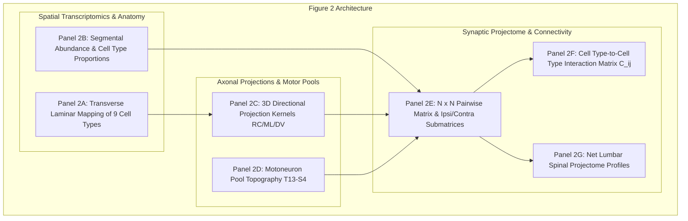

# Figure 2 Reproduction Plan: Spatial Transcriptomics, 3D Projection Kernels, Motoneuron Pools & Net Lumbar Projectome

**Paper**: Komi et al., *Nature Communications* (2026)  
**Title**: Emergence of Traveling Waves and Decoupled Motor Control in Spinal Projectomes  
**Original Repository Reference**: BergLab MATLAB Codebase (`InstantiateModel.m`, `00_SpinalNetworkModel/@Network/InstantiateNetwork.m`, `00_SpinalNetworkModel/@SpinalCordGeometry/SpinalCordGeometry.m`, `00_SpinalNetworkModel/@SpinalCordGenetics/SpinalCordGenetics.m`, `02_HelperFunctions/GenerateSynapticDistrib.m`)

---

## 1. Scientific Overview & Theoretical Context

Figure 2 constructs the realistic **3D anatomical and genetic architecture of the mouse lumbar spinal cord** ($T_{13} - S_4$, $\approx 11\text{ mm}$ longitudinal span) by integrating:
1. **Spatial Transcriptomics & Single-Nucleus RNA-seq Mapping**: Real anatomical coordinates for 20,755 sequencing voxels mapped across Rexed laminae (I–X) and 9 cardinal ventral cell types (Excitatory: V2a-1, V2a-2, V0v, V3; Inhibitory: V1, V2b, V0d, dI6; Motor: MN).
2. **Anisotropic 3D Gaussian Projection Kernels**: Directionally biased axonal projection clouds defined along Rostrocaudal (RC, $Z$), Mediolateral (ML, $X$), and Dorsoventral (DV, $Y$) axes with specific length scales $\mu_p$ and spatial std width $\sigma_{\text{spatial}} = 500\ \mu\text{m}$.
3. **Hindlimb Motoneuron Pool Topography**: Segmental distribution of 12 motor pools across $T_{13} - S_4$ from retrograde tracing and `matMuscleSeg.mat`, segregating rostral flexors ($L_1 - L_3$) and caudal extensors ($L_4 - L_6$).
4. **$N \times N$ Pairwise Projectome**: Sparse ($\approx 97.9\%$ sparsity), row-balanced, and rescaled synaptic matrix decomposing into ipsilateral and contralateral subcircuits.
5. **Cell Type–to–Cell Type Synaptic Matrix ($C_{ij}$)**: Quantitative interaction matrix between the 9 cardinal cell classes.
6. **Net Lumbar Spinal Projectome**: The emergence of the macroscopic asymmetric Mexican-hat projectome from cell-type-specific anisotropic Gaussian kernels.

---

## 2. Panel-by-Panel Scientific Specification

### 2.1 Panel 2A: Spatial Transcriptomics & Transverse Laminar Mapping
- **Biological Question**: Where are cardinal ventral locomotor interneurons and motoneurons located across the transverse spinal cord cross-section?
- **Data Sources**: `01_SpinalGeometryFiles/matGeometry.mat` (20,755 sequencing spots), `04_Utilities/CellTypesCensus.xlsx`.
- **Coordinates**: Transverse Mediolateral $X \in [-1750, 1750]\ \mu\text{m}$, Dorsoventral $Y \in [0, 1613]\ \mu\text{m}$.
- **Populations**: 9 cardinal cell types:
  - V2a-1, V2a-2 (intermediate zone, Laminae VII/VIII)
  - V0v, V3 (ventral/commissural, Lamina VIII)
  - V1, V2b (ventrolateral, Laminae VII/IX)
  - V0d, dI6 (ventromedial, Lamina VIII)
  - MN (ventral horn columns, Lamina IX)
- **Visuals**: Transverse spinal cross-section scatter plot color-coded by cardinal cell type with anatomical Rexed laminae boundaries.

### 2.2 Panel 2B: Segmental Distribution & Population Proportions
- **Biological Question**: What is the quantitative abundance of each neuronal class across the 11 lumbar-sacral segments ($T_{13} - S_4$)?
- **Data Sources**: `matGeometry.mat` (Segment lengths), `CellTypesCensus.xlsx` (cluster abundances).
- **Quantification**:
  - Total neurons instantiated at density $D = 0.8$: $N = 5,229$ neurons.
  - V1: $\approx 28.9\%$ ($1,511$ neurons)
  - V2a-2: $\approx 7.2\%$ ($375$ neurons)
  - V3: $\approx 17.5\%$ ($915$ neurons)
  - V0v: $\approx 9.5\%$ ($497$ neurons)
  - V2a-1: $\approx 6.4\%$ ($335$ neurons)
  - V2b: $\approx 6.1\%$ ($319$ neurons)
  - V0d: $\approx 9.5\%$ ($497$ neurons)
  - dI6: $\approx 12.2\%$ ($639$ neurons)
  - MN: $\approx 2.7\%$ ($141$ motoneurons)
- **Visuals**: Stacked segmental distribution bar chart along the longitudinal axis ($T_{13} \to S_4$).

### 2.3 Panel 2C: 3D Directional Projection Kernels (RC, ML, DV)
- **Biological Question**: What are the spatial reach and directional projection biases of each cardinal neuronal class?
- **Equations**:
  $$P_X^p(d_X) \propto \exp\left(-\frac{(d_X - \mu_X^p)^2}{2\sigma_X^2}\right), \quad P_Y^p(d_Y) \propto \exp\left(-\frac{(d_Y - \mu_Y^p)^2}{2\sigma_Y^2}\right), \quad P_Z^p(d_Z) \propto \exp\left(-\frac{(d_Z - \mu_Z^p)^2}{2\sigma_Z^2}\right)$$
- **Parameters** (`InstantiateModel.m`):
  - V2a-2: Length scale $\mu = 7000\ \mu\text{m}$, Bilateral RC (`bi`), Ventral DV (`ven`), Lateral ML (`lat`), Ipsilateral (`ipsi`).
  - V2a-1: Length scale $\mu = 500\ \mu\text{m}$, Caudal RC (`cau`), Ventral DV (`ven`), Medial ML (`med`), Ipsilateral (`ipsi`).
  - V1: Length scale $\mu = 2000\ \mu\text{m}$, Rostral RC (`ro`), Ventral DV (`ven`), Ipsilateral (`ipsi`).
  - V2b: Length scale $\mu = 4000\ \mu\text{m}$, Caudal RC (`cau`), Ventral DV (`ven`), Lateral ML (`lat`), Ipsilateral (`ipsi`).
  - V0v: Length scale $\mu = 3400\ \mu\text{m}$, Rostral RC (`ro`), Contralateral (`contra`).
  - V0d: Length scale $\mu = 500\ \mu\text{m}$, Local RC (`loc`), Contralateral (`contra`).
  - V3: Length scale $\mu = 500\ \mu\text{m}$, Caudal RC (`cau`), Ventrolateral (`lat`), Contralateral (`contra`).
  - dI6: Length scale $\mu = 5000\ \mu\text{m}$, Caudal RC (`cau`), Dorsomedial (`med`), Contralateral (`contra`).
  - MN: Length scale $\mu = 300\ \mu\text{m}$, Local RC (`loc`), Ipsilateral (`ipsi`).
- **Visuals**: Directional projection density curves for all 9 cell types across RC ($\Delta Z$), ML ($\Delta X$), and DV ($\Delta Y$) axes.

### 2.4 Panel 2D: Motoneuron Pool Topography ($T_{13} - S_4$)
- **Biological Question**: How are hindlimb flexor and extensor motoneuron pools organized along the lumbar enlargement?
- **Data Sources**: `01_SpinalGeometryFiles/matMuscleSeg.mat`, `04_Utilities/MotorneuronsDistribution.xlsx`.
- **Topography**:
  - Flexor-dominant pools (e.g. Tibialis Anterior [TA], Iliopsoas [IP], Extensor Digitorum Longus [EDL]): Rostral lumbar ($L_1 - L_3$).
  - Extensor-dominant pools (e.g. Gastrocnemius Medialis [GM], Soleus [Sol], Vastus Medialis [VM], Biceps Femoris [BF]): Caudal lumbar ($L_4 - L_6$).
- **Visuals**: Segmental distribution heatmap and rostrocaudal density curves of flexor vs extensor motor pools.

### 2.5 Panel 2E: Pairwise Connectivity Matrix ($W$) & Ipsi/Contra Decomposition
- **Biological Question**: What is the macroscopic and subcircuit structure of the complete spinal connectome?
- **Network Metrics**: $N = 5,229$ neurons, $570,740$ non-zero synapses ($97.91\%$ sparsity), row-wise zero-sum E/I balanced ($\sum_j W_{ij} = 0$).
- **Decomposition**:
  - Ipsilateral submatrix: $W_{\text{ipsi}}$ ($464,180$ synapses, $81.33\%$).
  - Contralateral submatrix: $W_{\text{contra}}$ ($106,560$ synapses, $18.67\%$).
- **Visuals**: Full $N \times N$ heatmap with zoom-in box and separate Ipsilateral and Contralateral connection heatmaps.

### 2.6 Panel 2F: Normalized Cell Type–to–Cell Type Interaction Matrix ($C_{ij}$)
- **Biological Question**: What are the relative synaptic interaction strengths between the 9 cardinal cell classes?
- **Equation**:
  $$C_{ij} = \frac{\sum_{k \in \text{type } i,\, l \in \text{type } j} |w_{kl}|}{\sum_{k \in \text{type } i} \sum_l |w_{kl}|}$$
- **Visuals**: $9 \times 9$ normalized connectivity matrix heatmap with annotated percentages and cell-type color bars.

### 2.7 Panel 2G: Net Lumbar Spinal Projectome Profiles
- **Biological Question**: Does the realistic 3D cell-type-specific connectivity produce the theoretical asymmetric Mexican-hat projectome at the macroscopic tissue scale?
- **Equation**:
  $$\text{Projectome}(\Delta z) = \frac{1}{N} \sum_{i, j \text{ s.t. } Z_i - Z_j \approx \Delta z} W_{ij}$$
- **Outputs**:
  - Net Ipsilateral Projectome: Emergent asymmetric Mexican hat (strong local excitation within $|\Delta Z| < 500\ \mu\text{m}$, flanked by surround inhibition extending $1000 - 4000\ \mu\text{m}$, with caudal directional skew).
  - Net Contralateral Projectome: Commissural inhibition/excitation profile regulating left-right coordination.
- **Visuals**: 1D projectome curves along $\Delta Z \in [-5000, 5000]\ \mu\text{m}$ with shaded excitatory and inhibitory sub-clouds.

---

## 3. MATLAB Codebase Mapping

| Paper Feature | MATLAB Function | Python Target |
| :--- | :--- | :--- |
| **Geometry & Transcriptomics** | `01_SpinalGeometryFiles/matGeometry.mat` | `src/data_loader.py:SpinalDataLoader` |
| **3D Directional Kernels** | `InstantiateModel.m` & `InstantiateNetwork.m` | `src/connectivity.py:compute_directional_biases` |
| **Motoneuron Pool Topography** | `matMuscleSeg.mat` & `MotorneuronsDistribution.xlsx` | `src/data_loader.py:SpinalDataLoader` |
| **Network Instantiation** | `InstantiateNetwork.m` | `src/network.py:Network` |
| **Cell-to-Cell Matrix $C_{ij}$** | Methods p. 13 | `src/figure2_analysis.py:compute_cell_type_connectivity_matrix` |
| **1D Net Projectome** | `02_HelperFunctions/GenerateSynapticDistrib.m` | `src/figure5_analysis.py:compute_projectome_1d_profile` |
| **Figure 2 Publication Plot** | Figures script | `src/figure2_analysis.py:generate_figure2_complete` |

---

## 4. Verification Plan

1. **Automated Unit Tests (`tests/test_figure2.py`)**:
   - `test_spatial_transcriptomics_data_integrity()`: Validates 20,755 sequencing spots, 9 cardinal types, and physical coordinate ranges ($X \in [-1750, 1750]\ \mu\text{m}, Y \in [0, 1613]\ \mu\text{m}$).
   - `test_motoneuron_pool_topography()`: Validates motor pool flexor/extensor segregation and segment distribution across $T_{13} - S_4$.
   - `test_directional_projection_kernels()`: Validates RC, ML, DV length scales and directional asymmetries for all 9 types.
   - `test_cell_type_connectivity_matrix()`: Validates $(9 \times 9)$ matrix normalization (rows sum to $1.0$) and positive non-negativity of weights.
   - `test_net_lumbar_projectome_mexican_hat()`: Validates local excitation peak and surround inhibition profile.
   - `test_figure2_panel_plotting_suite()`: Validates that all individual panel figures (2A–2G) and composite `figure2_complete.png` render without errors.
2. **Regression Testing**:
   - Run complete repository pytest suite to confirm all 58 existing tests (Figures 1, 3, 4, 5, 6) pass with 100% pass rate.
