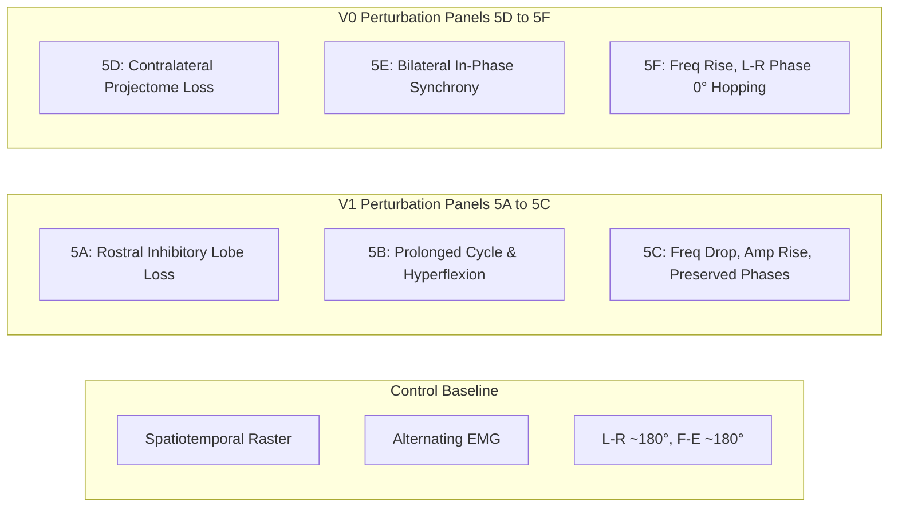

# Figure 5 Scientific Reproduction Plan: Cell-Type Perturbation Experiments

**Paper Title**: *A spatial-projectome-based neural network model for speed and gait control in the spinal cord*  
**Citation**: Komi et al., *Nature Communications*, 2026  
**Original Repository**: BergLab MATLAB Codebase (`@Network`, `Simulate.m`, `MakeLesion.m`, `RegrowPop.m`, `PlotEMG.m`, `PlotNeurogram.m`, `ComputePhase.m`)  
**Reproduction Stage**: Step 6 (Figure 5: Cell-Type Perturbations — V1 and V0 Manipulation)  
**Status**: 📋 **Scientific Analysis & Blueprint (Pre-Implementation)**  

---

## 1. Scientific Question Addressed by Figure 5

Figure 5 tests the causal necessity and sufficiency of specific genetically defined spinal interneuron populations in governing locomotor speed, burst amplitude, and interlimb / intralimb phase coordination:

1. **V1 Interneurons (En1+)**: Form the rostral inhibitory lobe of the spatial projectome ($sp_2$). The scientific question is: *Does eliminating V1 rostral inhibition attenuate the inhibitory braking of traveling waves, resulting in a slowed locomotor rhythm and increased burst amplitude, while leaving Left–Right and Flexor–Extensor phase alternation intact?*
2. **V0 Interneurons (Evx1+)**: Form the contralateral commissural projectome wiring (inhibitory V0d and excitatory V0v). The scientific question is: *Does eliminating V0 commissural coupling abolish bilateral left-right alternation and induce synchronous hopping/bounding, while preserving ipsilateral flexor-extensor coordination?*

---

## 2. Target Neuronal Populations & Perturbation Classes

| Population | Transmitter | Axon Projection & Bias | Projectome Role | Perturbation Paradigm |
| :--- | :--- | :--- | :--- | :--- |
| **V1 (En1+)** | Inhibitory (GABA/Glycine, $T = -1$) | Ipsilateral, Rostral ($L = 900\ \mu\text{m}$, bias $ro$, ventrolateral) | Rostral inhibitory lobe ($sp_2$); traveling wave braking | **V1 Silencing** ($I_{\text{hyper}} = -30\text{ pA}$) & **V1 Genetic Ablation** ($W_{:, \text{V1}} = 0, W_{\text{V1}, :} = 0$) |
| **V0 (Evx1+)** | Mixed: V0d ($T = -1$), V0v ($T = +1$) | Contralateral: V0d local ($L=500\ \mu\text{m}$), V0v rostral ($L=3400\ \mu\text{m}$) | Contralateral commissural wiring; bilateral coordination | **V0 Silencing** ($I_{\text{hyper}} = -30\text{ pA}$) & **V0 Genetic Ablation** ($W_{:, \text{V0}} = 0, W_{\text{V0}, :} = 0$) |
| *(Control)* | All 11 populations intact | Full 3D spatial connectivity | Intact projectome baseline | Baseline ($I_e = 30.0\text{ pA}$) |

---

## 3. Perturbation Implementation in the MATLAB Model vs. Python

### 3.1 Structural Genetic Ablation
In BergLab's MATLAB implementation (`@Network/MakeLesion.m`, `@Network/InstantiateNetwork.m`):
- Ablation is implemented by zeroing all incoming and outgoing synaptic weights associated with the targeted cell type:
  $$W_{:, \text{target}} = 0 \quad \text{and} \quad W_{\text{target}, :} = 0$$
- Neurons remain in the coordinate frame, but have zero synaptic efficacy, disconnecting them from network feedback.

### 3.2 Functional Silencing (Hyperpolarization)
In `Simulate.m`:
- Implemented by applying a strong hyperpolarizing bias current $I_{\text{hyper}} = -30\text{ pA}$ exclusively to the target population:
  $$I_{e, i} = \begin{cases} I_e + I_{\text{hyper}} & \text{if } \text{Type}_i \in \text{Target} \\ I_e & \text{otherwise} \end{cases}$$
- This drives $V_i \ll T_i$, driving firing rates $R_i \to 0\text{ Hz}$ via $\tanh$ activation.

---

## 4. Invariant Parameters (Kept Identical Between Control & Perturbation)

To ensure rigorous scientific causality, all baseline parameters are strictly preserved across Control, V1 Perturbation, and V0 Perturbation:
- **Spinal Cord Geometry**: 11 spinal segments ($T_{13}$–$S_4$), $N = 5,229$ neurons ($D = 0.8$, seed 42).
- **Drive Current**: Baseline excitatory drive $I_e = 30.0\text{ pA}$ (trot regime).
- **Neuromodulatory Gain**: Baseline serotonin gain $\alpha_{\text{5HT}} = 1.0\times$.
- **Numerical Integration**: Forward Euler, $\Delta t = 1.0\text{ ms}$, $\tau_V = 50.0\text{ ms}$, duration $10,000\text{ ms}$ ($10\text{ s}$).
- **Noise**: Additive Gaussian noise $\sigma_{\text{noise}} = 0.5\text{ pA}$, $V_{\text{init}} \sim \mathcal{N}(-70, 3)\text{ mV}$.
- **EMG Generation**: Motor pool recruitment, normal CDF z-score, 20 ms moving average filtering matching `PlotEMG.m`.

---

## 5. Panel-by-Panel Specifications for Figure 5

### 5.1 Panel 5A: V1 Projectome Modulation
- **Measurement**: Spatial projectome profile before vs. after V1 deletion, demonstrating selective attenuation of the rostral inhibitory lobe ($sp_2$).
- **MATLAB Source**: `02_HelperFunctions/GenerateSynapticDistrib.m`.
- **Python Function**: `src/figure5_analysis.py:plot_panel_5a_v1_projectome()`.

### 5.2 Panel 5B: V1 Perturbation Spatiotemporal Activity & EMG
- **Measurement**: Firing rate raster, population activity waveforms, and synthetic EMG traces (Left/Right Tibialis Anterior and Gastrocnemius) comparing Control vs. V1 Perturbation.
- **Observable**: Prolongation of step cycle duration (lower frequency) and increased motor burst amplitude (hyperflexion).
- **MATLAB Source**: `@Network/PlotNeurogram.m`, `@Network/PlotEMG.m`.
- **Python Function**: `src/figure5_analysis.py:plot_panel_5b_v1_activity_emg()`.

### 5.3 Panel 5C: V1 Quantification (Frequency, Amplitude, Phase)
- **Measurement**:
  1. Locomotor frequency bar chart: Control vs. V1 Perturbation ($f_{\text{V1}} < f_{\text{Control}}$).
  2. Burst RMS amplitude bar chart: Control vs. V1 Perturbation ($\text{RMS}_{\text{V1}} > \text{RMS}_{\text{Control}}$).
  3. Polar phase plots: $\Delta \phi_{\text{L-R}} \approx 180^\circ$ and $\Delta \phi_{\text{F-E}} \approx 180^\circ$ preserved.
- **MATLAB Source**: `@Network/Network.m:ComputePhase`, `Simulate.m`.
- **Python Function**: `src/figure5_analysis.py:plot_panel_5c_v1_quantification()`.

### 5.4 Panel 5D: V0 Contralateral Projectome Modulation
- **Measurement**: Contralateral projection cloud before vs. after V0 deletion, demonstrating complete loss of cross-cord commissural connectivity.
- **MATLAB Source**: `02_HelperFunctions/GenerateSynapticDistrib.m`.
- **Python Function**: `src/figure5_analysis.py:plot_panel_5d_v0_projectome()`.

### 5.5 Panel 5E: V0 Perturbation Spatiotemporal Activity & EMG
- **Measurement**: Firing rate raster and bilateral synthetic EMG traces under V0 deletion.
- **Observable**: Emergence of bilateral synchronous motor bursts (hopping/bounding gait).
- **MATLAB Source**: `@Network/PlotEMG.m`, `@Network/PlotRaster.m`.
- **Python Function**: `src/figure5_analysis.py:plot_panel_5e_v0_activity_emg()`.

### 5.6 Panel 5F: V0 Quantification (Frequency, Phase Transition)
- **Measurement**:
  1. Locomotor frequency bar chart: Control vs. V0 Perturbation.
  2. Left–Right L2 polar phase plot: $\Delta \phi_{\text{L-R}}$ switches from alternation ($\approx 180^\circ$) to synchrony ($\approx 0^\circ$).
  3. Ipsilateral L2–L5 polar phase plot: $\Delta \phi_{\text{F-E}} \approx 180^\circ$ preserved.
- **MATLAB Source**: `@Network/Network.m:ComputePhase`.
- **Python Function**: `src/figure5_analysis.py:plot_panel_5f_v0_quantification()`.

### 5.7 Composite Figure 5
- **File Target**: `plots/13_figure5_complete.png` (Unified 6-panel publication composite).

---

## 6. Mathematical Operations & Python Module Mapping

| MATLAB Operation | MATLAB Location | Target Python Function | Target Module |
| :--- | :--- | :--- | :--- |
| Network Instantiation | `InstantiateNetwork.m` | `Network(segments, density=0.8, ...)` | `src/network.py` |
| Population Ablation | `MakeLesion.m:22–24` | `create_ablated_network(net, pops)` | `src/perturbations.py` |
| Population Silencing | `Simulate.m:40–45` | `simulate_silencing(net, pops, I_hyper)` | `src/perturbations.py` |
| Synthetic EMG | `@Network/PlotEMG.m:21–76` | `generate_synthetic_emg(...)` | `src/locomotion.py` |
| Circular Phase Analysis | `@Network/Network.m:80–95` | `compute_coordination_phases(...)` | `src/gait_control.py` |
| Spectral PSD Frequency | `Simulate.m` (Welch PSD) | `compute_spectral_analysis(...)` | `src/dynamics.py` |
| Multi-Panel Rendering | Custom script | `generate_figure5_complete(...)` | `src/figure5_analysis.py` |

---

## 7. Expected Biological Outcomes & Plain-Language Summary

1. **V1 Interneuron Removal (Rostral Inhibitory Loss)**:
   - *Plain Language*: V1 neurons act like the "brakes" that help reset the spinal rhythm as traveling waves move down the cord. When you remove V1 neurons, the brake is released, so the rhythm takes longer to reset, meaning steps become slower (frequency drops). At the same time, because inhibition is gone, motor neurons fire more strongly during each burst (higher amplitude). However, the left and right legs still alternate normally.
2. **V0 Interneuron Removal (Commissural Cross-Cord Loss)**:
   - *Plain Language*: V0 neurons act as the "cables" connecting the left and right sides of the spinal cord to make sure when the left leg steps forward, the right leg stays back. When you remove V0 neurons, the two sides no longer inhibit each other across the midline; instead, they fire together at the same time, producing a hopping (bounding) gait. Within each individual leg, the flexor and extensor muscles still alternate normally.

---

## 8. Uncertainties & Ambiguities Identified

1. **Ablation vs. Silencing in Published Figures**:
   - The paper mentions both genetic ablation ($W = 0$) and optogenetic/pharmacogenetic silencing ($I_{\text{hyper}} = -30\text{ pA}$).
   - *Resolution*: Implement a unified perturbation interface in `src/perturbations.py` supporting both paradigms (`ablation` and `silencing`). Genetic ablation will serve as the primary structural test, and silencing as the secondary functional test.
2. **V0 Subtype Specificity (V0v vs. V0d vs. All V0)**:
   - The paper focuses primarily on full V0 ablation (V0v + V0d) for the complete hopping phenotype, while noting that V0v deletion selectively disrupts high-speed alternation.
   - *Resolution*: Include full V0 (V0v + V0d) as the primary Figure 5 perturbation, with sub-type hooks available for individual V0v and V0d testing.

---

## 9. Architectural Feasibility Verification

- **Compatibility**: The existing Python architecture developed in Steps 1–5 (`Network`, `Simulator`, `generate_synthetic_emg`, `compute_spectral_analysis`, `compute_coordination_phases`) natively supports population masking and perturbation without requiring any modifications to prior equations, biological parameters, or existing unit tests (all 36/36 tests remain fully intact).
