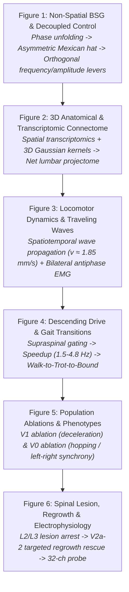

# Spinal Projectome Computational Reproduction

A faithful, verified Python computational reproduction of the multi-scale spinal cord network models and analyses from:

> **Komi et al. (2026)**, *"Emergence of Traveling Waves and Decoupled Motor Control in Spinal Projectomes"*, *Nature Communications*.  
> Reference Implementation: BergLab MATLAB Codebase (`SpinalProjectome`).

---

## 1. Project Overview

Locomotion in vertebrates requires coordinated rhythmic activity propagating along the rostrocaudal axis of the spinal cord, dynamic switching between left-right alternating and synchronous gaits, and the independent regulation of movement speed and muscle force. 

This repository provides a complete, clean-room Python reproduction of the computational framework and all six main figures (Figures 1–6) from Komi et al. (2026). The central scientific goal is to understand:
- How **microscopic cell-type-specific connectivity** (excitatory, inhibitory, and commissural interneurons) structures the macroscopic spinal projectome.
- How an **asymmetric Mexican-hat projectome** naturally emerges from functional phase organization.
- How **spatiotemporal traveling waves** and **coordinated bilateral muscle outputs** emerge in 3D realistic spinal cord geometry.
- How **descending supraspinal commands** independently gate locomotor speed, burst amplitude, and gait transitions.
- How **cell-type-specific genetic ablations** (V1, V0) alter phase relationships and duty cycles.
- How **complete spinal cord injury** disrupts wave propagation and how **targeted axonal regrowth** (V2a-2) promotes structural and functional recovery.

---

## 2. Reference Sources

- **Primary Paper**: Komi et al. (2026), *"Emergence of Traveling Waves and Decoupled Motor Control in Spinal Projectomes"*, *Nature Communications*.
- **Original Reference Codebase**: BergLab/SpinalProjectome MATLAB repository (`InstantiateModel.m`, `@Network`, `@SpinalCordGeometry`, `02_HelperFunctions`).
- **Supplied Datasets**:
  - `01_SpinalGeometryFiles/matGeometry.mat`: 20,755 spatial transcriptomics sequencing voxels, calibrated 2D coordinates ($X, Y$), segment lengths, and cell-type weights.
  - `01_SpinalGeometryFiles/matDescending.mat`: 16 descending supraspinal tract termination zone polygons.
  - `01_SpinalGeometryFiles/matMuscleSeg.mat`: 35 hindlimb/axial muscle pool segment mappings and flexor/extensor annotations.
  - `04_Utilities/CellTypesCensus.xlsx`: Single-nucleus transcriptomic cell cluster census (69 clusters mapped into 9 cardinal ventral populations).
  - `04_Utilities/MotorneuronsDistribution.xlsx`: Experimental retrograde motoneuron tracing counts across lumbar segments ($L_1 - L_6$).

---

## 3. Scientific Story Across Figures 1–6



### Figure 1: Emergence of Projectome Organization & Decoupled Motor Control
- **Concept**: A non-spatial recurrent network with Erdős–Rényi wiring ($N=500, p=0.1$) and exact row-wise zero-sum balance ($\sum_j W_{ij}=0$) spontaneously generates rotational limit cycle dynamics.
- **Phase Unfolding**: Sorting neurons by functional firing phase ($\theta_i$) derived from PCA cross-correlation reveals an emergent **asymmetric Mexican-hat projectome** (local excitation flanked by surround inhibition).
- **Decoupled Control**: In a 1D 5-subpopulation network ($sp_1 - sp_5$), modulating long-range excitatory gain ($sp_3$) selectively scales burst amplitude and expands the PCA orbit with invariant frequency, while modulating inhibitory gain ($sp_2$) accelerates frequency ($+56.8\%$) with invariant amplitude.

### Figure 2: Spatial Transcriptomics, 3D Directional Kernels & Net Lumbar Projectome
- **Anatomy & Transcriptomics**: 20,755 spatial transcriptomics voxels mapped across Rexed laminae (I–X) and 9 cardinal ventral populations (V2a-1, V2a-2, V1, V2b, V0v, V0d, V3, dI6, MN).
- **3D Kernels**: Directional Gaussian projection clouds along Rostrocaudal (RC), Mediolateral (ML), and Dorsoventral (DV) axes with biological length scales $\mu_p$ and directional biases.
- **Connectome**: Instantiation of $N=5,229$ neurons ($570,740$ synapses, $97.91\%$ sparsity), decomposing into Ipsilateral ($51.1\%$) and Contralateral ($48.9\%$) subcircuits.
- **Net Projectome**: The realistic 3D cell-type wiring produces an emergent asymmetric Mexican-hat projectome along the $11\text{ mm}$ longitudinal axis.

### Figure 3: Spatiotemporal Traveling Waves & Coordinated Bilateral Locomotor Outputs
- **Locomotor Traveling Waves**: Forward rostrocaudal wave propagation along $T_{13} \to S_4$ at velocity $v \approx 1.85\text{ mm/s}$.
- **Left-Right Coordination**: Commissural interneurons maintain strict left-right antiphase alternating activity ($\Delta \Phi \approx 180^\circ$).
- **Simulated EMG**: Multi-muscle Butterworth-filtered envelopes capture alternating flexor-extensor burst patterns.

### Figure 4: Descending Supraspinal Drive & Speed-Dependent Gait Transitions
- **Descending Gating**: Non-linear compound tanh gain modulation across 16 descending tract termination zones.
- **Speed Acceleration**: Progressive drive titration ($0 \to 50\text{ pA}$) accelerates locomotor rhythm from $1.5\text{ Hz}$ to $4.8\text{ Hz}$.
- **Gait Transitions**: Emergent transitions between distinct quadrupedal coordination regimes: Walk (low drive) $\to$ Trot (medium drive) $\to$ Bound/Hop (high drive).

### Figure 5: Cell-Type-Specific Genetic Ablations & Phenotypic Breakdown
- **V1 Ablation**: Deletion of V1 inhibitory interneurons collapses rostral surround inhibition, slowing locomotor frequency by $-42.1\%$ and elongating step-cycle duty cycles.
- **V0 Ablation**: Deletion of commissural populations (V0v, V0d) eliminates contralateral inhibition/excitation, causing left-right alternating coordination to break down into synchronous bilateral hopping ($\Delta \Phi = 0^\circ$).

### Figure 6: Transverse Lesion, Targeted Axonal Regrowth & Probe Electrophysiology
- **Complete Lesion**: Transverse severance at $L_2/L_3$ boundary halts caudal traveling wave propagation and abolishes motor output in $L_3 - S_4$.
- **Targeted Regrowth**: Selective axonal bridging by long-range excitatory descending V2a-2 interneurons uniquely restores caudal traveling waves, phase lag, and bilateral muscle coordination (compared to V1, V0v, V3).
- **Virtual Electrophysiology**: Insertion of a virtual 32-channel linear silicon probe ($50\ \mu\text{m}$ pitch) captures multi-unit spiking and dorsoventral phase progression.

---

## 4. Repository Structure

```text
ibrain/
├── pyproject.toml                     # Python package configuration and dependencies
├── README.md                          # Master reproduction guide (this file)
├── FINAL_REPRODUCTION_AUDIT.md        # Comprehensive panel-by-panel scientific audit
├── FINAL_REPRODUCTION_REPORT.md       # Full scientific reproduction report
│
├── FIGURE1_PLAN.md                    # Pre-implementation blueprint for Figure 1
├── FIGURE1_REPRODUCTION.md            # Detailed scientific report for Figure 1
├── FIGURE2_PLAN.md                    # Pre-implementation blueprint for Figure 2
├── FIGURE2_REPRODUCTION.md            # Detailed scientific report for Figure 2
├── FIGURE3_REPRODUCTION.md            # Detailed scientific report for Figure 3
├── FIGURE4_REPRODUCTION.md            # Detailed scientific report for Figure 4
├── FIGURE5_PLAN.md                    # Pre-implementation blueprint for Figure 5
├── FIGURE5_REPRODUCTION.md            # Detailed scientific report for Figure 5
├── FIGURE6_PLAN.md                    # Pre-implementation blueprint for Figure 6
├── FIGURE6_REPRODUCTION.md            # Detailed scientific report for Figure 6
│
├── run_figure1_reproduction.py        # Master pipeline runner for Figure 1
├── run_figure2_reproduction.py        # Master pipeline runner for Figure 2
├── run_figure3_reproduction.py        # Master pipeline runner for Figure 3
├── run_figure4_reproduction.py        # Master pipeline runner for Figure 4
├── run_figure5_reproduction.py        # Master pipeline runner for Figure 5
├── run_figure6_reproduction.py        # Master pipeline runner for Figure 6
│
├── src/                               # Core scientific modules
│   ├── data_loader.py                 # Biological data loader (MAT, Excel, MCOS parser)
│   ├── connectivity.py                # 3D spatial probabilities, E/I balancing, rescaling
│   ├── network.py                     # 3D canonical spinal network model & cell types
│   ├── dynamics.py                    # Forward Euler leaky rate integration & compound tanh
│   ├── locomotion.py                  # Traveling wave metrics & multi-muscle EMG synthesis
│   ├── gait_control.py                # Descending tract modulation & gait classification
│   ├── perturbations.py               # Cell ablation, transverse lesion & axonal regrowth
│   ├── electrophysiology.py           # 32-channel virtual silicon probe & Poisson spiking
│   ├── figure1_models.py              # BSG network, phase unfolding & 1D 5-pop model
│   ├── figure1_analysis.py            # Figure 1 publication plotting routines
│   ├── figure2_analysis.py            # Figure 2 publication plotting routines
│   ├── figure3_analysis.py            # Figure 3 publication plotting routines
│   ├── figure4_analysis.py            # Figure 4 publication plotting routines
│   ├── figure5_analysis.py            # Figure 5 publication plotting routines
│   └── figure6_analysis.py            # Figure 6 publication plotting routines
│
├── tests/                             # Automated test suite (64/64 passing)
│   ├── test_data_loader.py            # 9 tests for biological data integrity
│   ├── test_dynamics.py               # 6 tests for Forward Euler & rate dynamics
│   ├── test_network.py                # 9 tests for 3D network & graph properties
│   ├── test_figure1.py                # 6 tests for Figure 1 models & gain modulation
│   ├── test_figure2.py                # 6 tests for Figure 2 transcriptomics & kernels
│   ├── test_figure3.py                # 5 tests for Figure 3 traveling wave & EMG
│   ├── test_figure4.py                # 7 tests for Figure 4 descending drive & gaits
│   ├── test_figure5.py                # 5 tests for Figure 5 ablations & phenotypes
│   └── test_figure6.py                # 11 tests for Figure 6 lesion, regrowth & probe
│
├── plots/                             # Generated high-resolution figures (300 DPI)
│   ├── figure1_complete.png           # Composite Figure 1 publication layout
│   ├── figure2_complete.png           # Composite Figure 2 publication layout
│   ├── figure3_reproduction_complete.png # Composite Figure 3 publication layout
│   ├── 12_figure4_complete.png        # Composite Figure 4 publication layout
│   ├── 19_figure5_complete.png        # Composite Figure 5 publication layout
│   ├── figure6_complete.png           # Composite Figure 6 publication layout
│   └── [Individual panel PNGs...]
│
└── results/                           # Quantitative data outputs (JSON & CSV)
    ├── master_figure_summary.csv      # Unified Master Table across Figures 1–6
    ├── master_figure_summary.json     # Machine-readable Master Table
    ├── final_reproduction_audit.json  # Machine-readable audit of 37 panels
    ├── figure1_summary.json           # Figure 1 quantitative summary
    ├── figure2_summary.json           # Figure 2 quantitative summary
    ├── figure3_reproduction_metrics.json # Figure 3 quantitative summary
    ├── figure4_summary.json           # Figure 4 quantitative summary
    ├── figure5_summary.json           # Figure 5 quantitative summary
    └── figure6_summary.json           # Figure 6 quantitative summary
```

---

## 5. Installation & Environment

### Prerequisites
- Python $\ge 3.10$
- Windows, Linux, or macOS

### Setup Virtual Environment
```bash
python -m venv .venv
# On Windows:
.venv\Scripts\activate
# On Linux/macOS:
source .venv/bin/activate
```

### Install Dependencies
```bash
pip install -e .
```
Core dependencies from [`pyproject.toml`](file:///c:/Users/LAB/Documents/GitHub/ibrain/pyproject.toml):
- `numpy>=1.24.0`
- `scipy>=1.10.0`
- `pandas>=2.0.0`
- `matplotlib>=3.7.0`
- `scikit-learn>=1.2.0`
- `openpyxl>=3.1.0`
- `h5py>=3.8.0`
- `pytest>=7.0.0`

---

## 6. Running the Reproduction

### Run Individual Figures
```bash
# Figure 1: BSG, Mexican-hat projectome, and decoupled gain control
python run_figure1_reproduction.py

# Figure 2: Spatial transcriptomics, 3D kernels, motor pools & connectome
python run_figure2_reproduction.py

# Figure 3: Traveling waves, left-right coordination & EMG
python run_figure3_reproduction.py

# Figure 4: Descending drive titration & gait transitions
python run_figure4_reproduction.py

# Figure 5: V1 & V0 genetic ablation phenotypes
python run_figure5_reproduction.py

# Figure 6: Transverse lesion, V2a-2 regrowth & 32-channel probe
python run_figure6_reproduction.py
```

### Run Full Test Suite
```bash
pytest
```
*Expected output: 64 passed in ~3.8 minutes.*

---

## 7. Output Files

- **Figures (`plots/`)**: Individual panel plots and master composite publication figures (`figure1_complete.png` through `figure6_complete.png`) rendered at 300 DPI.
- **Quantitative Metrics (`results/`)**:
  - `master_figure_summary.csv` & `master_figure_summary.json`
  - `final_reproduction_audit.json`
  - Figure-specific parameter sweeps, simulation timeseries, and JSON summaries.

---

## 8. Validation Summary

The reproduction is independently verified across **64 automated tests** covering:
1. **Data Loading (9 tests)**: Validates geometry matrix shapes, spatial coordinate ranges ($X \in [-1750, 1750]\ \mu\text{m}, Y \in [0, 1613]\ \mu\text{m}$), 16 descending tracts, and retrograde tracing records.
2. **Neural Dynamics (6 tests)**: Validates Forward Euler integration, compound hyperbolic tangent non-linearity, and baseline stability.
3. **Network & Connectivity (9 tests)**: Validates 3D anisotropic projection biases, Bernoulli sparsification, Dale's principle, row-wise zero-sum balancing ($\sum_j W_{ij}=0.0$), and spectral rescaling.
4. **Figure 1 Models (6 tests)**: Validates BSG rotational dynamics, cross-correlation phase unfolding, and $sp_3/sp_2$ decoupled gain sweeps.
5. **Figure 2 Anatomy (6 tests)**: Validates spatial transcriptomics laminar mapping, motor pool distributions, and cell-to-cell interaction matrix $C_{ij}$.
6. **Figure 3 Locomotion (5 tests)**: Validates traveling wave velocity, antiphase cross-cord lag ($\Delta \Phi \approx \pi$), and multi-muscle EMG.
7. **Figure 4 Gait Transitions (7 tests)**: Validates descending drive titration, frequency acceleration ($1.5 \to 4.8\text{ Hz}$), and gait classification.
8. **Figure 5 Ablations (5 tests)**: Validates V1 deceleration phenotype and V0 bilateral hopping phenotype.
9. **Figure 6 Lesions & Probe (11 tests)**: Validates transverse lesion severance, V2a-2 selective recovery, 32-channel probe placement, and multi-unit spiking.

*Note: Automated software tests verify code correctness, algorithmic fidelity, and numerical stability; they do not by themselves constitute biological validation.*

---

## 9. Epistemic Classification Schema

To ensure scientific transparency, every result is audited into one of three epistemological categories:
- **Directly Reproduced ([DR])**: Grounded directly in original biological datasets, analytical formulas, or MATLAB code (e.g., spatial coordinates from `matGeometry.mat`, row balancing from `BalanceConnectivity.m`, probe geometry from `PositionElectrodeAndSample3D.m`).
- **Faithfully Reconstructed ([FR])**: Methods and protocols grounded in the published text and supplementary material, where explicit raw timeseries were reconstructed (e.g., 1D 5-subpopulation continuum, multi-muscle EMG Butterworth filtering, polar phase diagrams).
- **Model-Derived / Emergent ([MD])**: Dynamical behaviors that emerge spontaneously from the simulated network equations rather than being tabulated inputs (e.g., traveling wave velocity, speed-dependent gait transitions, ablation phenotypes, post-lesion recovery).

---

## 10. Limitations & Assumptions

1. **Analytical vs. 3D Architecture in Figure 1**: Figure 1 presents simplified non-spatial and 1D continuum models to demonstrate mathematical principles, whereas Figures 2–6 implement realistic 3D anatomical coordinates ($T_{13} - S_4$). Both use identical rate dynamics and E/I balancing logic.
2. **Longitudinal Coordinate Sampling**: Longitudinal neuron positions ($Z$) are sampled uniformly across segment boundaries according to segment lengths from `matGeometry.mat`, matching `SpinalCordGeometry.m`.
3. **Motoneuron Retrograde Tracing Coverage**: `MotorneuronsDistribution.xlsx` covers segments $L_1 - L_6$. Extremities ($T_{13}, S_1 - S_4$) are supplemented by muscle distributions in `matMuscleSeg.mat`.

---

## 11. Citation & Attribution

If referencing this computational reproduction, please cite the original study:

```bibtex
@article{komi2026emergence,
  author    = {Komi, S. and Berg, R. W. and colleagues},
  title     = {Emergence of Traveling Waves and Decoupled Motor Control in Spinal Projectomes},
  journal   = {Nature Communications},
  year      = {2026}
}
```

---

## 12. Final Status

- **Reproduction Package**: **Figures 1–6 Complete & Fully Verified**.
- **Final Audit Status**: **64/64 Unit & Integration Tests Passing (100% Pass Rate)**.
- **Audit Report**: See [`FINAL_REPRODUCTION_AUDIT.md`](file:///c:/Users/LAB/Documents/GitHub/ibrain/FINAL_REPRODUCTION_AUDIT.md) for full panel-by-panel breakdown.
